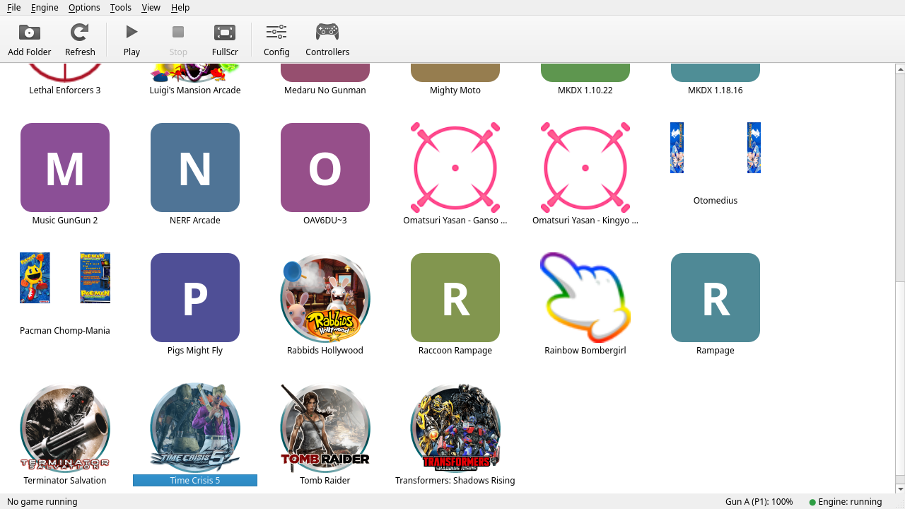
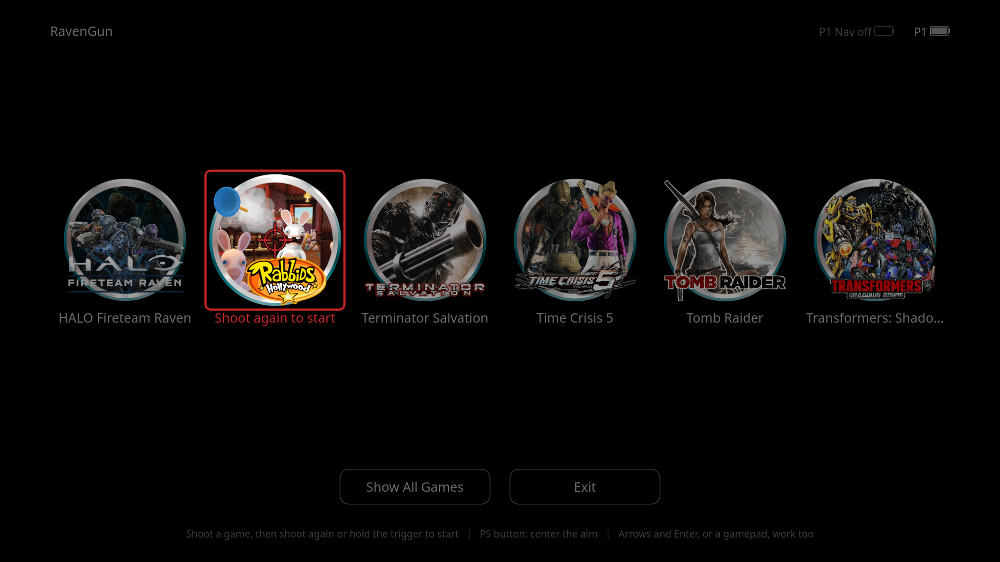
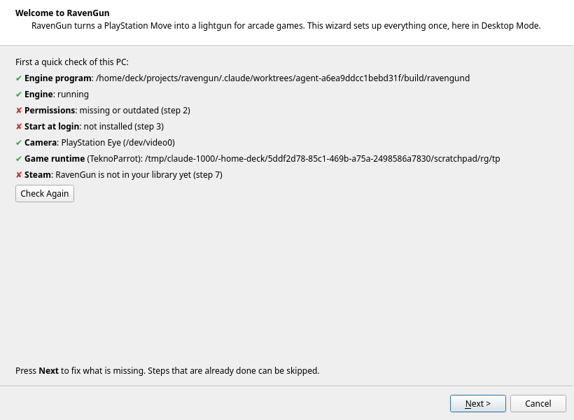

# RavenGun

Play arcade lightgun games on a Steam Deck (or another SteamOS/Arch PC) with a **PlayStation Move** as the gun.

RavenGun turns the Move into a virtual lightgun and gives you one app, in the style of the Dolphin emulator, for everything around it: your game library, per-game options, controllers, calibration and settings. It also has a full-screen mode for the TV and Steam Game Mode, where you pick a game by shooting at it.

## What you need

Hardware:

- One or more **PlayStation Move ZCM1** controllers (the original Move with the magnetometer).
- A **PlayStation 3 Eye** camera (it watches the glowing ball of the Move and corrects drift).
- Optional: a **Sharp Shooter** gun shell and/or a **Navigation Controller** for extra buttons.
- A Bluetooth adapter (the Steam Deck has one) and a USB cable for pairing the Move.

Software:

- **SteamOS 3.x** (Steam Deck) or **Arch Linux** with **KDE Plasma**, with Qt 6.11 or newer (SteamOS has it).
- Your own **arcade game dumps**. RavenGun contains no games.
- For games that need it, the **TeknoParrot runtime** with your own TeknoParrot subscription. RavenGun contains no TeknoParrot components.

Not every game works. See [docs/compatibility.md](docs/compatibility.md) for what has been tried.

## Install (Desktop Mode)

1. Download `ravengun-<version>-x86_64-steamos.tar.gz` and `ravengun-<version>-x86_64-steamos.sha256` from the Releases page of this repository.
2. Open a terminal (Konsole) in the folder you downloaded them to and check the download:

       sha256sum -c ravengun-<version>-x86_64-steamos.sha256 --ignore-missing

3. Unpack and install. No root and no changes to the read-only system partition are needed:

       tar xf ravengun-<version>-x86_64-steamos.tar.gz
       cd ravengun-<version>-x86_64-steamos
       ./install.sh

   This installs into `~/.local/opt/ravengun`, adds a menu entry and a desktop icon, and starts the engine (the background service) at every login.
4. Start **RavenGun** from the application menu. The first start opens the **setup wizard**. It installs the permissions (one password prompt), pairs your PS Move, calibrates it on the TV, adds your game folder and adds RavenGun to Steam.

## Game Mode

When the wizard is done, restart into Game Mode and start **RavenGun** from your Steam library (under Non-Steam games). It opens the full-screen menu: aim the Move at a game and shoot to select it, shoot again to start it. The PS button centers the aim. When a game ends you are back in the menu.

## Update

Download the new archive and run `./install.sh` again. The program files are replaced; your settings, library and calibration stay. If a game is running, the engine keeps running the old version until you restart it (**Engine > Restart** in the app).

## Uninstall

    ~/.local/opt/ravengun/share/ravengun/scripts/uninstall-user.sh

This stops and removes the services and shortcuts and deletes the installation folder. It asks for your password once to remove the device rules and the Bluetooth helper that the wizard installed (use `--keep-root` to skip that). Your settings are kept unless you add `--remove-config`. Your games, the TeknoParrot runtime and other data in `~/.local/share/ravengun` are never removed. Remove the RavenGun entry from your Steam library yourself.

## Troubleshooting

- **The installer says libraries are missing or too old.** The app needs Qt 6.11 or newer. Update SteamOS, or on Arch install `qt6-base`.
- **The app says the engine is not running.** Use **Engine > Start Engine** in the app. In a terminal: `systemctl --user status ravengund` and the log `~/.local/state/ravengun/logs/ravengund.log`.
- **The Move is not found.** Press its PS button. If it was never paired, use **Pair New Controller** in the **Controllers** window (USB cable, then PS button).
- **A game does not see the gun.** Run the **Permissions** step of the wizard again (**Tools > Setup Wizard**). Then restart the game.
- **A game does not start or does not work.** Check [docs/compatibility.md](docs/compatibility.md) first; many arcade games are not supported yet. Check the **Advanced** page in **Settings** for the log of the last start.
- **A quick health check:** `~/.local/bin/ravengunctl doctor` lists what is missing (camera, Bluetooth, permissions).

More help is in the in-app user guide (**Help > User Guide**, or [docs/user-guide.md](docs/user-guide.md)).

## Build from source

The build notes are in [docs/build.md](docs/build.md) (Dutch). In short: `scripts/build-app.sh` builds the app in a container with Qt 6.11, `cmake -S . -B build && cmake --build build` builds the engine, and `tools/dev/make-release.sh` builds the release archive reproducibly in containers.

## License

RavenGun is free software under the **GNU General Public License, version 3 or later** (see [LICENSE](LICENSE)). Code and files from other projects, with their licenses, are listed in [THIRD_PARTY.md](THIRD_PARTY.md).

RavenGun is not affiliated with Sony, TeknoParrot or any game publisher. "PlayStation" is a trademark of Sony Interactive Entertainment.
